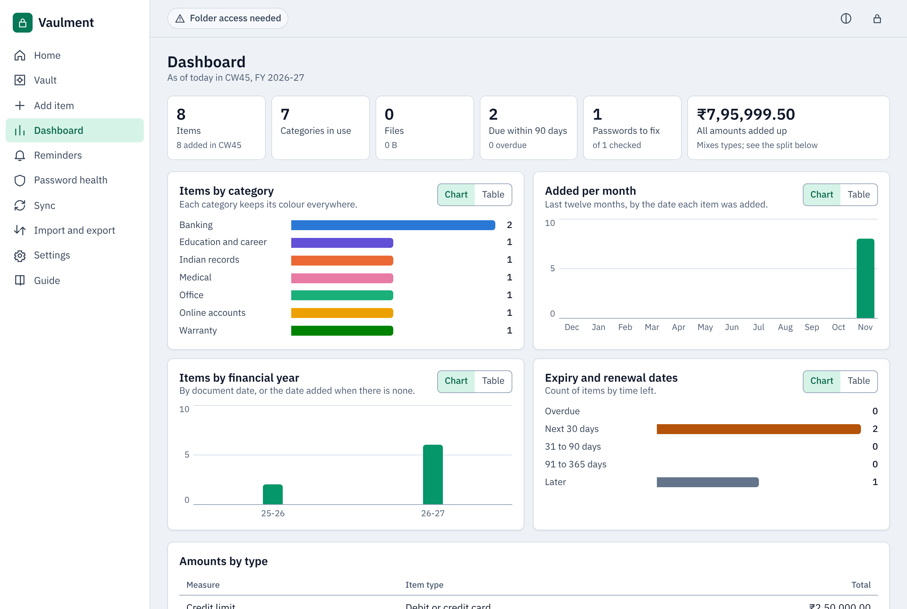

# Vaulment

A private vault for bank details, Indian records, office papers, online accounts, medical reports, warranties, certificates and anything else you must not lose. It runs in the browser, encrypts everything on your device, and keeps working offline.

**Live:** <https://sathyanarayanan-2001.github.io/vaulment/>



## Features

- Thirteen item types across eight categories, plus your own categories
- Scans, photos and PDFs up to 25 MB each, encrypted like everything else
- Search, favourites with one-tap copy, trash with restore
- Dashboard with counts, financial-year and month views, and exact rupee totals; every chart switches to a table
- Reminders for renewal and expiry dates; password health for weak, reused and old passwords
- Sync across devices through your own OneDrive folder, merged item by item
- CSV import with a preview, CSV export, encrypted backups
- Works offline, installs as an app, dark and light themes, phone layout down to 320 px

## Privacy

- No accounts, analytics or server. The page's security policy blocks it from making network requests at all.
- All data is encrypted with AES-256-GCM. The key comes from your master password (PBKDF2-SHA256, 600,000 rounds) and never leaves the device.
- OneDrive only ever receives encrypted files.
- Nobody can reset your master password. Keep the recovery key on paper.

See [SECURITY.md](SECURITY.md) for what this does and does not protect against.

## Getting started

Open the live address in Chrome or Edge, create a vault, save the recovery key, then follow the quick start. Device-by-device steps are in [docs/SETUP.md](docs/SETUP.md).

To work on the code:

```text
npm ci
npm run build
npm run serve
npm run verify
```

## Documents

[Setup](docs/SETUP.md), [Architecture](docs/ARCHITECTURE.md), [Worked examples](docs/WORKED-EXAMPLES.md), [Quality record](docs/QUALITY.md), [Verification](docs/VERIFICATION.md), [Performance](docs/PERFORMANCE.md), [Known limits](docs/KNOWN-LIMITS.md), [Changelog](CHANGELOG.md), [Contributing](CONTRIBUTING.md).

## Licence

MIT. IBM Plex Sans is embedded under the SIL Open Font License (`src/fonts/OFL.txt`).
